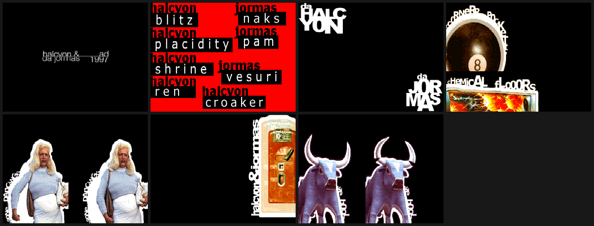
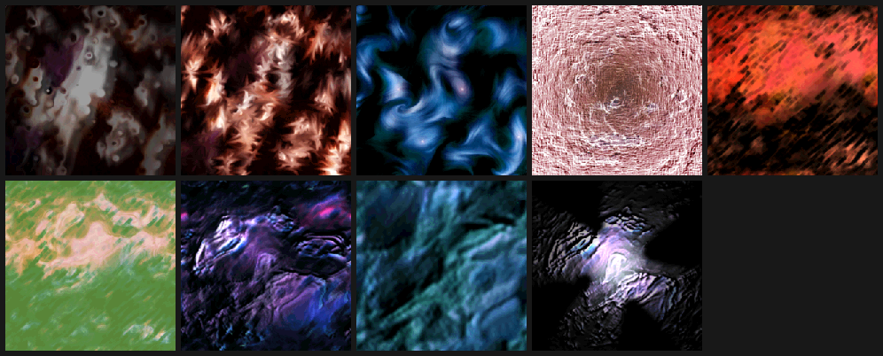
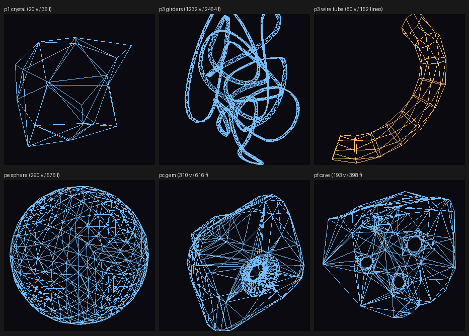

# Saint (Halcyon & Da Jormas, Assembly 1997): the effects

Saint is a DOS demo by Halcyon & Da Jormas (Assembly 1997 final). It uses mode 13h (320x200, 256 colours) and a 32-bit protected-mode flat program (PMODE). This document explains what is on screen, how each effect works, and what the JS port reproduces exactly. The assembly side is in [`WRITEUP-asm.md`](WRITEUP-asm.md); the long-form process log is `docs/PROCESS.md`.

## At a glance

Every part of the demo is the same engine, a "halcyon super kolmedee enkine (tm)" (the banner string in the EXE): a tunnel renderer drawn through a 41x26 grid of warped rays, plus a depth-sorted list of 3D objects drawn on top. All looks come from a handful of 256x256 textures, a palette fade, and a few meshes.







## Display and timing

- **Aspect ratio.** Mode 13h pixels are not square on a 4:3 monitor: 320x200 is shown at 4:3 (each pixel about 1.2x taller than wide). The figures above are already drawn at 4:3.
- **Clock.** The original advances on a 70.086 Hz retrace tick (the ISR does the palette blend and the part state). The port uses the S3M music (libopenmpt via chiptune3) as the master clock: the demo is S3M order/row driven, so tick = music position.
- **Rows are not equal.** Orders 12-27 have 64 rows of 55.6 ms, the others about 110 ms. `row_times.json` and `order_times.json` give the exact times used.
- **Seek and pause.** Seek = replay the part from its start up to the target tick (some state, like the part E sphere rotation, depends on frame history). Pause stops the music clock.

## Timeline

Times are music seconds in the port (`scenes/index.js`).

| Part | Start | What it is |
|---|---|---|
| intro | 0 | smeared footage, 142 frames, 2x upsampled |
| part 1 | 14.222 | "saint" tunnel with translucent crystals |
| part 2 | 35.111 | orange tunnel, textured star |
| part 3 | 78.222 | space tunnel with girders and wire tubes |
| D | 113.778 | metaballs through the grid |
| A | 120.889 | textured landscape |
| B | 128 | cylinder with a cone of lines and shards |
| intro again | 135.111 | repeat of the intro |
| E | 145.963 | textured sphere inside a box |
| F | 182.326 | textured cave lit by a rotating star |
| C | 211.417 | plane tunnel melting into a sphere, gem, dancer, final picture |
| end | 262.3 | final picture held 10 s (700 ticks) |

`docs/PROCESS.md` section 12 lists older times on a different clock (intro 0-21.333, P1 to 42.222, P2 to 81.778, P3 to 117.333, D to 124.444, A to 131.556, B to 138.69, intro 2 to 153.236, E to 189.599, F to 218.69, C to 262.3). The two lists disagree (the older one is on a different clock), so the table above follows the port code.

## The tunnel: rays through a 41x26 grid

The screen is cut into 8x8 blocks, so only 41x26 vertices need real work. Per vertex the code rotates the grid point by the camera matrix, adds the camera position, casts the ray from the camera through it, and calls a **warp** that returns `(u, v, shade)` of the hit point. The rest is cheap interpolation.

```js
// engine/tunnel.js
const P = [M0*x+M1*y+M2*z+O0, ...];       // grid point in world space
let r = warp(O, P, k);                    // -> [u, v, shade]
V[i] = Math.round(r * 65535);             // 16.16 fixed point
blit8(out, V, tex, shade);                // bilinear over each 8x8 block, then shade[z][tex[v][u]]
```

The five warps (offsets in the program):

- **0x29d9a cylinder** (radius 32 around z): quadratic ray hit, `u = |atan2(...)|/pi*255`, `v` along the axis, with a sinusoidal wobble on the hit parameter `t`.
- **0x29f62 cylinder without wobble** (part B).
- **0x2a0f5 plane z = -400**: hit point, with a "water" wobble `sin(hx*w1)*w2 + cos(hy*w1)*w2` on `t`; `u,v = hit*0.16 + 128`.
- **0x2a22a plane z = -300** (part C): `u,v = hit*0.16 + 128`, fog `63 - min(-600 t, 63)`.
- **0x2a30b sphere** (radius `sqrt(190000)`): the camera is inside, `u,v` from the hit coordinates.

The shade is a fog value 0..63 from the hit distance, so distant parts of the tunnel go dark through the shade table. Two warps can be morphed by blending their `(u,v,shade)` outputs in float32 (`new*b + old*(1-b)`), which is how the plane turns into the cylinder in part 1 and the plane into the sphere in part C.

The sphere wobble reads a leftover float (`[0x296b0]`) in the original; the port reproduces it as the constant 1042.643.

## Per-part effects

### Intro

Footage stored as nibble RLE, upsampled 2x and smeared by two table-driven filter passes (see the asm write-up, section 9). The frame shown is `floor(tick/7) mod 142`. The palette is driven by the same ISR blend as everywhere else.

### Part 1: the crystal tunnel

A plane warp morphs into a cylinder warp (`blendOn` starts at spline index 0x140 and lasts 500 ticks). 33 translucent filter-triangle crystals and 33 flares are placed in a cluster that rotates around Z by `0x4d9/65536` rad per tick. The camera follows a Catmull-Rom spline (0x1f2c0) with a look-at matrix (0x15d91). The palette A/B pulses (`1023 - (cos(pulse)*511 + 511)`), the screen flashes black in the last rows of order 4 and fades to white from order 5, row 0x30. Part 1 ends at order 5, row 60.

```js
// parts/p1_tick.js, per tick
S.rot += 0x4d9;                                // cluster rotation
S.t1 += s; S.t2 += s;                          // camera speed rises while the ramp is open
```

The crystals are not alpha-blended: each pixel under a triangle is remapped through the 64-level filter table (asm write-up, section 3).

### Part 2: orange tunnel and the star

Cylinder-to-sphere tunnel, 50 dust glows from an LCG, and a 105-vertex / 206-face star whose vertices are `shapeA*w + shapeB*(1-w)` with `w = 4*sin(3*sin(a)*cos(b))`. The star is drawn with a perspective-correct textured Gouraud rasteriser (0x1fefc), intensity `I = 128*(d.N)/|d|^2`. A logo sprite is composited on top.

### Part 3: space tunnel

A sphere-warp tunnel with a flat-shaded girder mesh (1232 vertices, 2464 triangles), three anti-aliased wire tubes (80 vertices, 152 lines each in the figure) and 50 dust glows. Two camera paths A and B are cut by a script table (`[0x33c20]`). Overlay sprites (the 8-ball and "chemical floors" image, 0x189197) come on top. Each face has a glow level that decays to a floor of 16 or 24.

### Part D: metaballs

A two-centre distortion is drawn through the same 41x26 grid (formulas in `parts/pd.js`), so the "metaballs" are really texture coordinates bent around two points. Text sprites appear on a schedule. The grid is built after the blit, so each frame shows the grid of the previous tick.

### Part A: landscape

A textured Gouraud landscape (203 vertices, 353 faces) with a light at `[0x4950] = 192`, the camera moving `t += 0.0173` per tick.

### Part B: cone of lines and shards

A cylinder warp without wobble, a grid cone made of `Line` objects (anti-aliased wire) and filter-triangle shards.

### Part E: sphere in a box

A textured sphere clamped by an invisible box (half-size `[0x48c4]`) with cumulative rotation, a grid cage and a bull sprite overlay (0x1b88b5). The rotation is **stateful**: the state depends on the whole frame history, so seeking replays from the start of the part.

### Part F: the cave

A textured cave (193 vertices, 398 faces) lit by a rotating glowing star, and a 1-bit overlay at the end.

### Part C: plane tunnel, gem, dancer

A plane tunnel melting into a sphere (cross-fade by `1/1050` per tick after spline index 0x410), a gem (310 vertices, 616 faces) with five pentagon stars, 36 shards, a directional sprite (0x296d8: one of 40 views chosen from `atan2`), a dancer strip, and the final picture (image 0xcb4b9).

### Hidden feature

Pressing keys toggles warps (`[0x41c4..c6]`) and palettes (`[0x419b..]`). The strings in the EXE also contain decoys such as `ratavek.juu`.

## What is exact and what is approximated

Differences against the Unicorn emulation of the original, **per 64000-pixel frame**. These numbers are copied from `docs/PROCESS.md` (sections 6, 7, 10, 11); the reference snapshots are not present in this tree, so they were not re-run for this write-up.

| Part | Differing pixels |
|---|---|
| intro | 0 |
| D | 0 |
| P3 | 0 (900 ticks of ISR also identical) |
| P1 | tunnel exact; whole frame 1 pixel off |
| P2 | tunnel 8 |
| B | 2 |
| E | 40-80 |
| C | 3-344 |
| F | 270-1500 |
| A | about 700 |

The textured-triangle rasteriser was validated on 40/40 and 160/177 triangles identical, the others differing by 1-3 pixels (extended-precision rounding). Palettes were always equal. The FPU model matters: the drawing stage runs in round-toward-zero with a 24-bit mantissa (set by PMODE), and `engine/texmap.js` follows that.

Objects and tables built at load time by the original (`tex.bin`, `shade.bin`, `filter.bin`, `sprites.bin`, `objects.json`) are exported from snapshots, not regenerated.

### Not reproduced

- Sub-tick effects of the real machine (the ISR runs asynchronously on the original).
- The roughly 0.4 s silent load between the intro and part 1.

## The art

17 ColoRIX images (`RIX3`, width and height as 16-bit values, a 768-byte 6-bit VGA palette, then `w*h` pixels at offset +778) are embedded in the EXE; `tools/extract_rix.py` extracts them to `site/assets/img`. The nine 256x256 ones are the tunnel textures, byte-exact matches of the per-part `tex.bin`:

| Image offset | Part |
|---|---|
| 0x1f533d | P1 |
| 0x205647 | P2 |
| 0x225c5b | P3 |
| 0x1d4d29 | A |
| 0x1e5033 | B |
| 0xe15e3 | C |
| 0x215951 | D |
| 0x235f65 | E |
| 0x26692f | F |

Also byte-exact: part 2 overlay = 0x1a8bab, bull = 0x1b88b5, part D sheet = 0xf18ed, part 3 overlay = 0x189197, and the final picture starts with 0xcb4b9. Not confirmed: the part 1 overlay (14400 bytes, probably 0x1c85bf, 320x45), the intro overlay, the part C strip and sheet, and the part F overlay. There are no separate font assets; the text is part of the RIX pictures.

The music is an S3M module ("da tonemonob itch", 359368 bytes at EXE offset 0x115e03, 4 channels, three tunes mixed into one) played by libopenmpt. Credits found in the EXE: blitz code, shrine/placidity/croaker graphics, ren meshes, naks/pam/vesuri music, asmu player, tran PMODE.

The figures were rendered from the extracted assets by a throwaway script (not kept in the tree); the mesh figure leaves out the landscape (A) and part B meshes, because the B projection was degenerate and A too thin to read.
